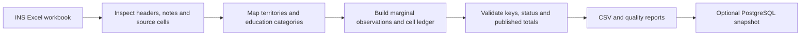

# Education statistics ETL and quality assessment

This portfolio project converts Romanian census Table 3.1 into a validated, reproducible dataset. The National Institute of Statistics of Romania reports the resident population by completed education, sex and residence area as of 1 December 2021 in its final Population and Housing Census results. The workbook covers Romania, 41 counties and Bucharest Municipality.



The explicit Romanian classification retains university branches, repeated fields of study, secondary and its upper and lower branches, high school types, vocational and apprenticeship education, primary and early childhood education. English names are descriptive translations. See [methodology](docs/methodology.md), [source mapping](docs/source_mapping.md), [data dictionary](docs/data_dictionary.md) and [quality rules](docs/data_quality_rules.md).

## Run in Windows PowerShell

From this directory, with Python 3.11 or later and the authorised workbook in the parent directory:

```powershell
py -3 -m venv .venv
.\.venv\Scripts\python.exe -m pip install -e ".[test]"
$python = ".\.venv\Scripts\python.exe"
& $python -m education_etl.cli inspect --input ..\Tabel-3.01.xlsx
& $python -m education_etl.cli run --input ..\Tabel-3.01.xlsx --output-dir output
& $python -m education_etl.cli validate --input output\education_statistics_2021.csv
& $python -m education_etl.cli load-postgres --input output\education_statistics_2021.csv --dry-run
& $python -m pytest -q
```

Copy the source to `data/raw/` if preferred and pass that path explicitly. Set `EDUCATION_TEST_WORKBOOK` for integration testing with a different source location. The project makes its fixed Table 3.1 scope explicit. The reference configuration and coversheets may change in future releases, so supply an updated `--config` and review the source contract before using a new workbook. Worksheet dimensions, separators, and row numbers are discovered at run time. A file log is written beneath `logs/`; pass `--log-level DEBUG` to display exception traces. Exit codes are 0 for successful execution, 1 for an operational failure, and 2 for validation failure. For a full run, `--strict` also treats warnings as validation failures.

## Results from the supplied workbook

| Metric | Result |
|---|---:|
| Worksheets processed | 43 of 43 |
| Source statistical rows | 2,107 |
| Source statistical cells | 14,749 |
| Analytical observations | 10,621 |
| Dashboard records | 2,107 |
| Numeric observations | 10,346 |
| Confidential observations | 168 |
| Unresolved dashes in analytical output | 107 |
| Structural dashes retained in the source ledger | 4,128 |
| Rejected cells | 0 |
| Quality errors and warnings | 0 |
| Numerical comparisons unavailable | 357 |

The asterisk and dash totals independently reconcile to 168 and 4,235 across source statistical cells. The CSV preserves suppressed and unresolved values with null counts. It provides distinct sex and residence margins. The ledger keeps the raw placeholders in G and H outside territorial totals. Start with `output/data_quality_report.html` and `output/etl_run_summary.json`.

## Optional PostgreSQL

Install `.[postgres]`, set `EDUCATION_DATABASE_URL` for a local demonstration database, and call `load-postgres` without `--dry-run`. Reserved snapshots, transactional replacement, the psql COPY contract and analytical views are described in the [database model](docs/database_model.md). CSV generation and validation run independently of PostgreSQL.

## Dashboard extract and reproducibility

Each run writes `output/education_statistics_dashboard_2021.csv` from the same observations written to the long CSV. It pivots seven published measures and matches their values and statuses back to the long records. Each dashboard row represents a territory and education category. The 43 territorial totals alone have a count for residents with no completed education or under age two. The resident total is calculated only when the three exhaustive age and education-status components are all numeric.

The strict run passed with no errors or warnings. The 23 pytest tests passed and the database dry-run passed. Live PostgreSQL loading remains unverified. The dashboard view is defined in `sql/07_dashboard_view.sql`.

The `src/` directory contains the Python package, `config/` contains census mappings, `tests/` contains automated checks, and `sql/` contains schema and views. Use the [source and attribution note](data/raw/README.md) to obtain the workbook. The [MIT licence](LICENSE) covers the code and original documentation. The original XLSX remains local. The derived outputs cite INS and preserve published suppression. See the [publication checklist](PUBLICATION_CHECKLIST.md).
