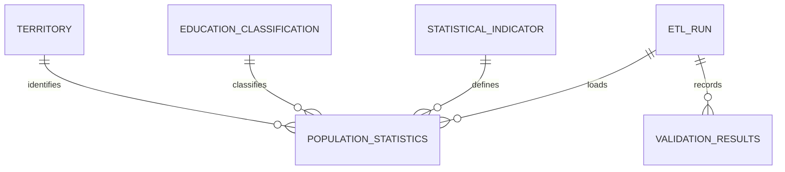

# PostgreSQL model and loading



The preferred loader uses psycopg 3, COPY FROM STDIN, a transaction advisory lock and a staging table lock. It validates schema compatibility before connection and checks reference and marker consistency after COPY. The transaction replaces only dates represented in staging. A repeated CSV hash reuses the run ID. A matching local run manifest and quality report supply QA rows. Use only a complete, successful snapshot as loader input. Table 3.1 is the only dataset stored in the schema. The SQL has not been executed against PostgreSQL in this workspace.

For manual staging in psql, start from the project directory. Install schema and table definitions using scripts 01 and 02, then run the following:

```sql
\set ON_ERROR_STOP on
BEGIN;
\i sql/03_load_staging.sql
\copy staging.education_statistics_raw FROM 'output/education_statistics_2021.csv' WITH (FORMAT csv, HEADER true, ENCODING 'UTF8', NULL '\N', FORCE_NULL (parent_category_id,population_count,raw_value))
SELECT count(*) FROM staging.education_statistics_raw;
ROLLBACK;
```

To finalise manually, load the territory and category CSVs into their reference tables, register the CSV hash and UUID in qa.etl_run, set psql variable `run_id`, then run scripts 04, 05 and 06 inside the staging transaction before COMMIT. The Python loader performs these actions and can attach QA.

Analytical views preserve single geographical and classification levels at each record. Filter territory_level explicitly before any geographic rollup. For total sex and residence views, the scope is already the territorial total. The education-level view includes the `level` category type. Use the base fact for secondary sublevels and below. Select a single education depth or a verified non-overlapping set before aggregating.

`education.dashboard_2021` in script 07 pivots the 2021 snapshot on its assessment grain. Each fact is unique by series and source cell. The view carries individual statuses and a nullable calculated resident total. The optional loader installs this view. For manual deployment include script 07 after 06. The view has not been executed on a live server.
